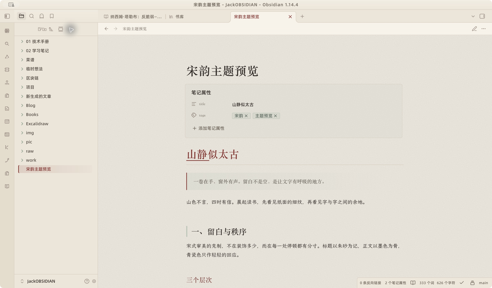
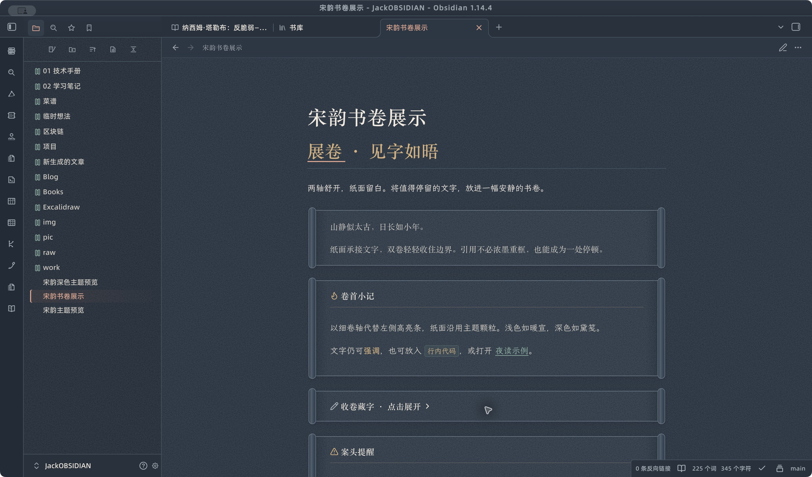
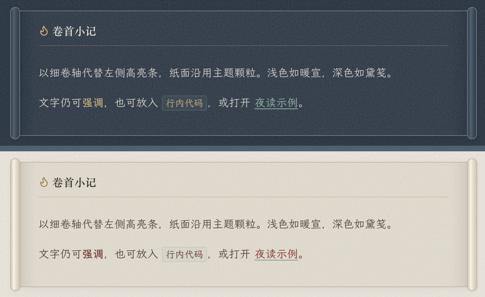
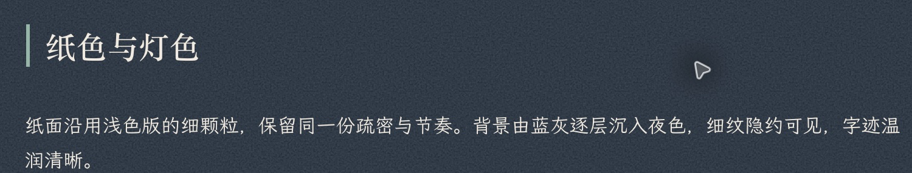
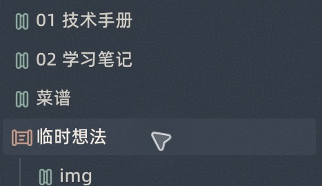
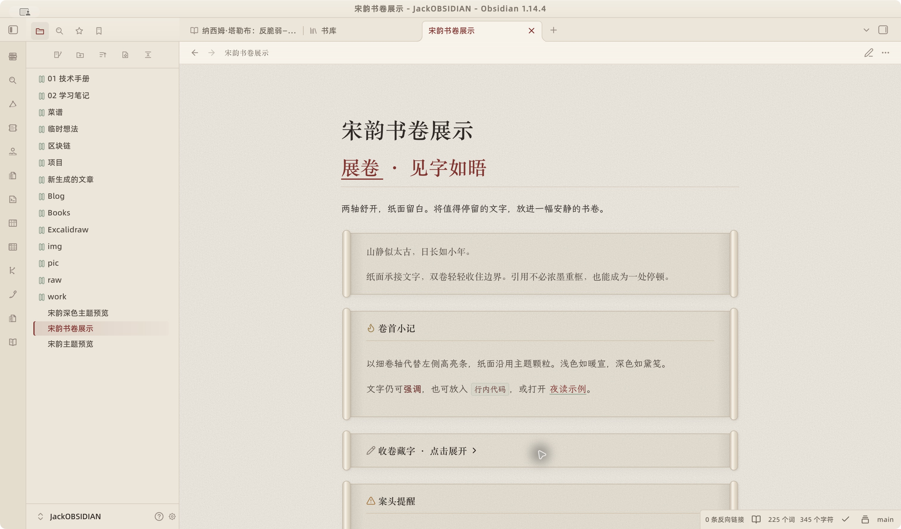
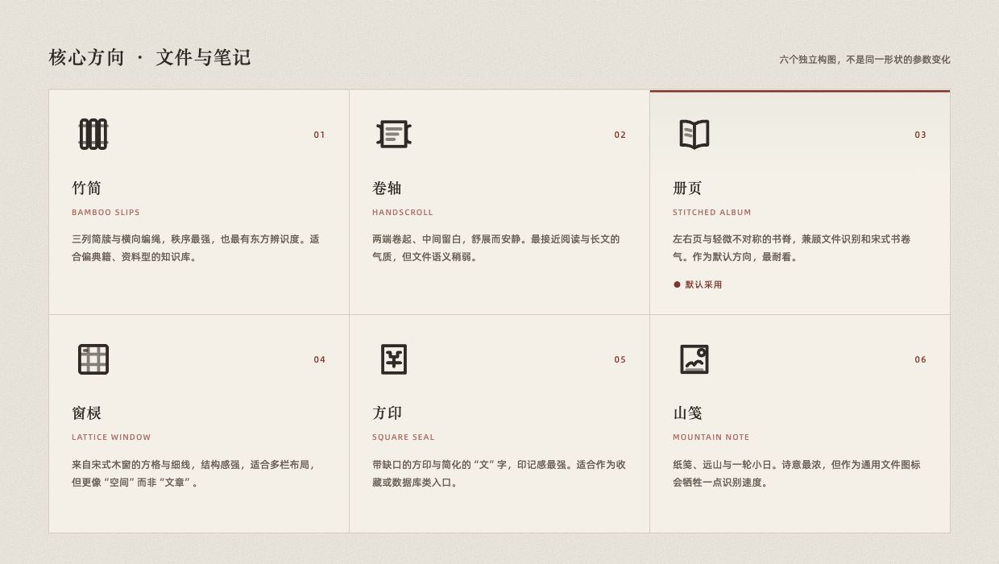
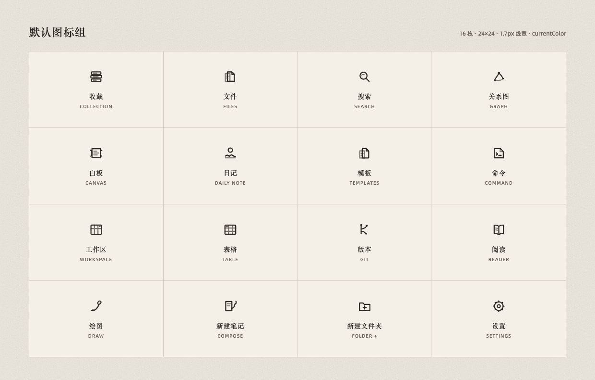
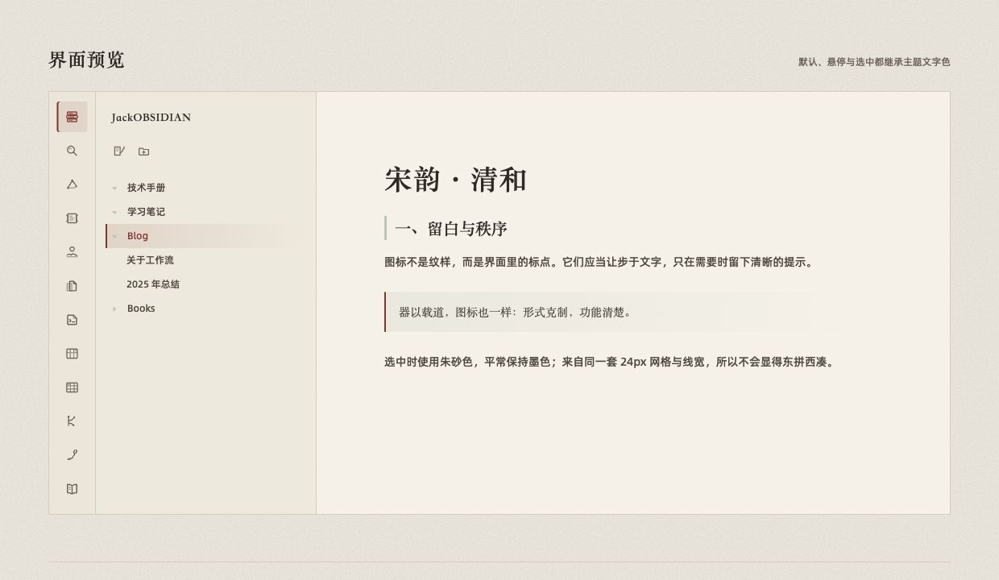

# Songyun Qinghe · 宋韵·清和

> 一套以宋式审美为线索的 Obsidian 主题。白日暖纸墨字，夜读黛蓝米白，以书卷、细线与留白承接文字。

**版本：1.2.2** · 适配 Obsidian 1.6+ · [MIT License](LICENSE)

Songyun Qinghe is a community-made, Song-inspired Obsidian theme with light and dark palettes, paper grain, scroll-style callouts, and matching line icons. It works offline and does not load remote fonts or images.

官方主题库名称为 [Songyun Qinghe](https://community.obsidian.md/themes/songyun-qinghe)，中文名为「宋韵·清和」。



## 深浅双色

浅色模式以暖宣纸色为底，正文使用低饱和墨色，标题和交互状态使用绛红。深色模式「灯下观书」以黛蓝为底、米白为字，暖金标题与青玉链接呼应，陶红点缀交互。

| 浅色模式 | 深色模式 |
| --- | --- |
|  |  |

## 特点

- **宋式纸面**：深浅色模式共用 128px 均匀细颗粒，浅色为暖纸底、深色为黛蓝底；深色用明暗颗粒与柔光混合增强纹理。
- **层次化配色**：正文、次文字、标签、标题和代码各有独立色阶，不依赖大面积高饱和色。
- **宋版标题**：标题使用宋体，浅色 H1 以绛红呈现，深色 H1 使用暖金；H2 以灰绿或青玉细竖线建立秩序。
- **阅读优化**：正文行高、段距和行宽均为长文阅读调整，最大行宽可在 Style Settings 中调整。
- **完整 Markdown 样式**：覆盖引用、表格、任务列表、标签、脚注、Callout、代码块、嵌入内容和图片。
- **展开书卷**：引用与 Callout 采用左右双轴、细边纸面和主题颗粒，保留提示类型与折叠操作，适配阅读和实时预览。
- **深色模式**：独立黛蓝纸面、暖金标题、青玉链接与陶红交互，同时适配表格、代码、属性、弹窗和图标。
- **内置图标**：宋式线描图标与文件夹双卷状态现已包含在主题 CSS 中，无需额外启用片段；覆盖左侧 Ribbon、侧栏标签和文件工具栏。
- **双态书卷**：文件夹箭头替换为左右双卷，收起时靠拢，展开时舒开并露出纸面；子文件夹独立响应状态。
- **轻量实现**：纸面颗粒由内联 CSS/SVG 生成，不依赖外部图片、字体或网络资源。

## 色板

| 角色 | 色值 | 用法 |
| --- | --- | --- |
| 绛红 | `#8C2F2D` | 主强调、H1、当前文件 |
| 胭脂 | `#B76F6A` | 悬停、列表标记、次强调 |
| 暖灰 | `#8E8075` | 次级文字、图标、分隔 |
| 灰绿 | `#B7C5B7` | 标签、H2 竖线、柔和点缀 |
| 宣纸 | `#EDE6D9` | 侧栏与纸面层 |
| 浅纸 | `#F8F3E9` | 正文阅读区域 |

### 深色 · 灯下观书

| 角色 | 色值 | 用法 |
| --- | --- | --- |
| 黛蓝 | `#4F6072` | 边框、层次与深色底色的基准 |
| 陶红 | `#B56A58` | 按钮与交互点缀 |
| 暖金 | `#D9B07C` | 一级标题、粗体、行内代码 |
| 青玉 | `#8DB8A7` | 链接、标签、三级标题 |
| 米白 | `#F1EADF` | 正文与笔记标题 |

正文纸底为 `#2B3744`，侧栏为 `#26313D`，Ribbon 为 `#212C37`。陶红小字号文字采用较亮的衍生色 `#E0A18D`，按钮文字使用深墨色。两种模式使用同一套颗粒图案、频率和种子；深色使用中性灰颗粒、增强的明暗对比和 `soft-light` 柔光混合，SVG 透明度为 `0.30`，保持黛蓝纸底。

切换方式：「设置 → 外观 → 基础颜色 → 深色」。示例笔记见 [`examples/宋韵深色主题预览.md`](examples/宋韵深色主题预览.md)。

## 界面截图

以下为 Obsidian 1.14.4（macOS）中的实际界面，使用本文推荐字体；正文为仓库中的示例笔记。v1.2.1 将图标内置于主题，延续图中的外观。

### 浅色模式


### 深色模式


### 书卷文本块与纸面细节





### 文件夹双卷状态



## 展卷文本块

原有引用块与 Callout 会自动变为展开书卷，不需要额外插件或修改笔记。左右细卷轴收住纸面，浅色使用暖宣，深色使用黛笺；提示类型通过卷首图标和题签细线区分。

| 浅色书卷 | 深色书卷 |
| --- | --- |
|  |  |

```markdown
> 山静似太古，日长如小年。

> [!tip] 卷首小记
> 将值得停留的文字，放进一幅安静的书卷。

> [!note]- 收卷藏字 · 点击展开
> 原有折叠操作继续可用。
```

示例笔记：[`examples/宋韵书卷展示.md`](examples/宋韵书卷展示.md)。阅读模式显示完整书卷，实时预览中的连续引用行共用双轴，便于直接编辑。

## 宋韵图标

图标组以宋版册页、竹简、窗棂和器物轮廓为灵感，统一为 `24×24` 画布、`1.7px` 线宽和单色描边。图标继承 `currentColor`，默认呈墨色，悬停与选中时转为朱砂色。

### 六个核心方向



1. **竹简**：三列简牍与横向编绳，秩序感最强。
2. **卷轴**：两端卷起、中间留白，舒展安静。
3. **册页**：左右页与轻微不对称书脊，作为默认方向。
4. **窗棂**：方格与细线，呼应多栏工作区。
5. **方印**：带缺口的方印与简化“文”字。
6. **山笺**：纸笺、远山与一轮小日，诗意最强。

### 完整图标组



覆盖入口：收藏/数据库、文件、搜索、关系图、白板、日记、模板、命令面板、工作区、表格、Git、阅读器、绘图、新建笔记、新建文件夹、设置、文件目录、收藏、书签、排序、定位当前文件和展开/折叠全部。

### 图标在界面中的效果



图标展示页源文件：[`宋韵·清和/icon-preview.html`](宋韵·清和/icon-preview.html)

文件夹双卷开合预览：[`宋韵·清和/folder-scroll-preview.html`](宋韵·清和/folder-scroll-preview.html)。v1.2.1 默认内置双卷图标，保留原生点击与文件树缩进。

[查看图标展示页完整长图](screenshots/icon-preview-full.png)

## 安装

### 从官方主题库安装

进入「设置 → 外观 → 主题 → 管理」，搜索 **Songyun Qinghe**，安装后启用。已安装的用户可在外观设置中检查主题更新。

### 方式一：手动安装

1. 将 `宋韵·清和/` 复制到你的 vault：

   ```text
   <你的 Vault>/.obsidian/themes/宋韵·清和/
   ```

2. 打开 Obsidian，进入「设置 → 外观」。
3. 在主题列表中选择「宋韵·清和」。主题已包含宋韵图标，无需额外片段。

独立的 `snippets/宋韵图标.css` 仍保留，供旧版主题或仅需要图标的用户使用。升级到 v1.2.1 后，可关闭之前单独启用的「宋韵图标」片段，避免重复加载。

### 方式二：命令行

```bash
git clone https://github.com/jackyoung022/Obsidian-SongStyle.git

VAULT="/path/to/your/vault"
cp -R Obsidian-SongStyle/宋韵·清和 "$VAULT/.obsidian/themes/"
```

### 方式三：发布包

下载仓库中的 [`dist/Obsidian-SongStyle-v1.2.2.zip`](dist/Obsidian-SongStyle-v1.2.2.zip)。发布包使用 ASCII 文件名以兼容跨平台解压：

- 将 `Songyun-Qinghe/` 复制到 `.obsidian/themes/`。
- 图标已内置，`snippets/songyun-icons.css` 为可选的独立片段。

手动安装包显示为「宋韵·清和」；官方目录使用根目录清单中的 **Songyun Qinghe**。

## 设置

### 推荐字体

为接近 README 截图，推荐以下组合。字体需先安装到操作系统，再在「设置 → 外观 → 字体」中选择；主题包不包含字体文件，也不会联网加载字体。

| 使用位置 | 推荐字体 | Obsidian 中的名称 | 设计用途与下载 |
| --- | --- | --- | --- |
| 正文 | 霞鹜文楷 | `LXGW WenKai` | 笔画舒展，用于札记和长文。[官方项目与下载](https://github.com/lxgw/LxgwWenKai) |
| 界面 | 阿里巴巴普惠体 2.0 | `Alibaba PuHuiTi 2.0` | 用于文件列表、设置和工具栏，让小字号信息保持清楚。[官方字体站](https://www.alibabafonts.com/) |
| 代码 | JetBrains Mono | `JetBrains Mono` | 用于代码块和等宽文本，代码中的中文由后续字体回退显示。[官方下载](https://www.jetbrains.com/lp/mono/) |
| 标题、卷首题签 | 宋体 / 思源宋体 | `Songti SC` / `Source Han Serif SC` | 未指定正文字体时优先使用宋体。手动更换正文字体后，标题、引用和题签会随之更新。其他平台可安装[思源宋体](https://github.com/adobe-fonts/source-han-serif)。 |

截图使用的设置：

```text
界面字体：Alibaba PuHuiTi 2.0
正文字体：LXGW WenKai
等宽字体：JetBrains Mono
字体大小：16px
正文行宽：780px（主题默认值）
```

自 v1.2.2 起，Obsidian 的界面、正文与等宽字体设置优先于主题默认值。安装字体后如列表尚未刷新，重新打开 Obsidian 再选择。不同版本字体可能显示中文名称，选择对应的字体家族即可。未安装所选字体时，会使用主题与系统提供的后备字体。

### Style Settings（可选）

安装 [Style Settings](https://github.com/mgmeyers/obsidian-style-settings) 后，在主题设置里可以调整：

- **正文栏宽度**：默认 `780px`，范围 `640–1040px`。
- **使用 Obsidian 原生图标**：开启后恢复原生图标；默认关闭，显示宋韵图标。

### 恢复原生图标

在 Style Settings 的「宋韵·清和」设置中，开启「使用 Obsidian 原生图标」。如果此前还启用了旧版独立的「宋韵图标」片段，也请关闭该片段。

### 恢复其他主题

在「设置 → 外观 → 主题」中切换回原主题即可。

## 自定义

主题的主要变量集中在 `宋韵·清和/theme.css` 顶部的 `body` 规则中：

```css
--song-rouge: #8C2F2D;
--song-rouge-light: #B76F6A;
--song-warm-gray: #8E8075;
--song-celadon: #B7C5B7;
--song-paper: #EDE6D9;
--song-paper-front: #F8F3E9;
--song-reading-width: 780px;
```

纸面颗粒由 `--song-paper-grain-fine` 控制，当前为 `128px` 平铺。若想更明显，可以增加该变量 SVG 中的 `opacity` 值；若想更轻，则降低该值。浅色变量位于 `body`，深色覆盖位于 `body.theme-dark`，两者分别调整。

## 文件结构

```text
Obsidian-SongStyle/
├── README.md
├── LICENSE
├── manifest.json              # 官方目录读取的清单：Songyun Qinghe
├── theme.css                  # 可直接安装的完整主题，含内置图标
├── screenshot.png             # 512×288 商店预览
├── versions.json
├── scripts/
│   └── prepare_release.py     # 同步主题文件并构建手动安装包
├── 宋韵·清和/
│   ├── manifest.json
│   ├── theme.css
│   ├── icon-preview.html
│   ├── folder-scroll-preview.html
│   ├── icons/
│   │   ├── *.svg
│   │   └── variants/
│   │       └── file-*.svg
│   └── README.md
├── snippets/
│   └── 宋韵图标.css
├── screenshots/
│   ├── obsidian-light.png
│   ├── obsidian-dark.png
│   ├── scroll-block-light.png
│   ├── scroll-block-dark.png
│   ├── scroll-block-comparison.png
│   ├── dark-paper-detail.png
│   ├── folder-scroll-ui.png
│   ├── icon-hero.png
│   ├── icon-directions.png
│   ├── icon-set.png
│   ├── icon-preview-full.png
│   └── icon-ui.png
├── examples/
│   ├── 宋韵主题预览.md
│   ├── 宋韵深色主题预览.md
│   └── 宋韵书卷展示.md
└── dist/
    └── Obsidian-SongStyle-v1.2.2.zip
```

## 兼容性

- 最低 Obsidian 版本：`1.6.0`
- 实测版本：`1.14.4`（macOS）
- 图标替换依赖现代 CSS `:has()` 选择器
- 不依赖额外插件；Style Settings 仅用于可选的行宽设置
- 主题 CSS 不引用远程字体或图片

## 设计说明

- 背景颗粒的**视觉节奏**参考了 [中国色](https://zhongguose.com/) 的均匀细颗粒处理；未复制该站点的纹理图片或颜色。
- 色板与主题方向来自个人宋式审美项目。
- 图标按 “宋版册页” 方向生成并统一线宽、留白和小尺寸识别度。
- 预览截图使用仓库内的示例笔记，不包含个人笔记内容。

## 更新记录

### 1.2.2

- 修复 Obsidian 外观设置中的界面、正文和等宽字体选择被主题覆盖的问题。标题、引用及提示块题签也跟随正文选择。
- 左下角设置按钮恢复原生齿轮，沿用 Obsidian 默认图标尺寸和点击区域。

### 1.2.1

- 准备官方主题库提交，根目录补齐 `manifest.json`、`theme.css` 和商店预览图。
- 官方提交名为 Songyun Qinghe，保留中文品牌「宋韵·清和」。
- 将宋韵图标与双卷文件夹内置到主题，增加恢复原生图标的可选设置。
- 添加 MIT 许可证和可重复执行的发布构建脚本。

### 1.2.0

- 新增「灯下观书」深色配色，以黛蓝、陶红、暖金、青玉与米白建立层次。
- 深浅模式使用相同的细颗粒纹样，深色以明暗颗粒和柔光混合增强纹理。
- 修复设置下拉框的箭头重复平铺，保留原生图标尺寸、位置和交互。
- 文件夹新增双卷开合图标，收起与展开均保留左右双卷。
- 引用和提示块改为展开书卷，增加深浅色纸面、卷首题签和左右卷轴；保留原生编辑与折叠。
- 补齐深色 RGB 变量，修正标题栏、状态栏、表格和属性等区域的浅色残留。
- 调整深色按钮文字、链接、标签、代码和 Callout，增加深色示例笔记与截图。
- 补充推荐字体、字体安装与外观设置说明，更新完整界面及书卷细节截图。

### 1.1.1

- 补齐侧栏标签与文件工具栏图标。
- 恢复侧栏标签及按钮的固定尺寸和间距。
- 图标总数扩展至 22 枚并更新预览页。

### 1.1.0

- 完成宋韵图标组与 Obsidian 工具栏接入。
- 修复隐藏原生图标后 Ribbon 按钮行距过密的问题。
- 增加图标方向、完整图标组和界面预览。
- 补齐发布文档、示例笔记与截图。

### 1.0.0

- 初始宋式主题：色彩、纸面、标题、表格、引用、代码块和深色模式。

## License

本项目的原创主题 CSS、图标与文档采用 [MIT License](LICENSE)。使用、修改和再分发时，请保留版权及许可声明。

Obsidian 商标与第三方字体属于各自的权利人；主题包不附带第三方字体文件。
