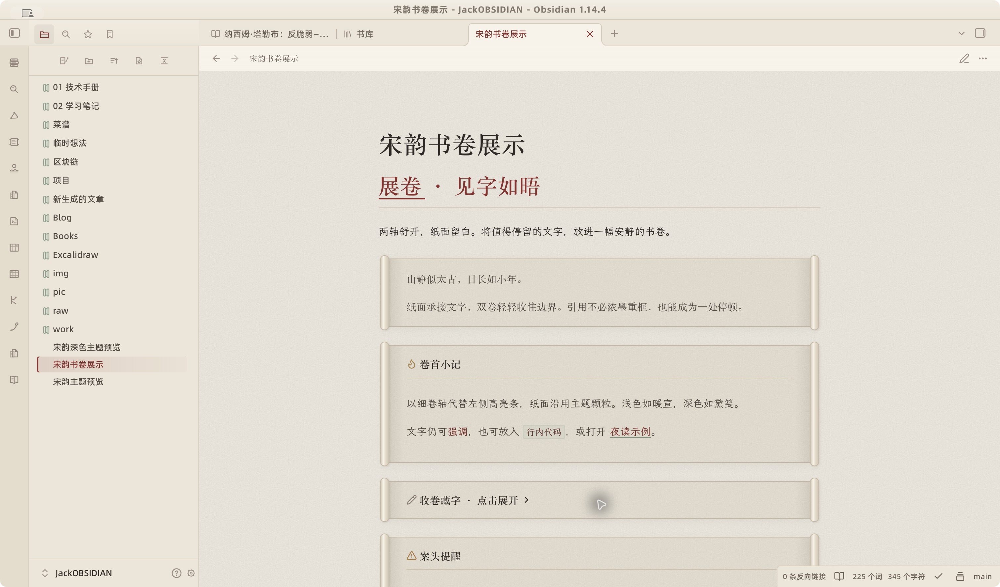

# 案头清笺 · 实用宋韵

> 山静似太古，日长如小年。写技术方案与读书札记，都可在同一张素笺上完成。

打开笔记时，宽屏两侧以极淡细栏收束纸面，既保留**宋式笺纸的留白与秩序**，又不挤占工作笔记的行宽与扫读效率。行内可使用 ==朱批高亮==、*斜体或圈点批注*、~~校勘删改~~ 与 `inline_code()`。

---

## 一、工作笔记核心组件

### 1.1 任务清单与多级列表

- 方案评审与架构梳理
  - 梳理核心 CSS 变量闭环
    - 核对深浅五套宋色对比度
  - 验证 Live Preview 与阅读视图一致性
- [x] 完成卷首牌记与乌丝栏表谱样式
- [x] 完成碑拓代码块与宣纸图片装裱
- [ ] 在本地 Obsidian Vault 实测并微调细节

1. 先定纸色与墨度
2. 再定栏线与鱼尾节奏
3. 最后按需开启圈点、首行缩进与单篇笺纸

### 1.2 乌丝栏表谱（工作数据对照）

| 色系名称 | 适用模式 | 主纸底色 | 气质取向 |
| :--- | :--- | :--- | :--- |
| 清和（默认） | 浅色 | 暖宣 `#F8F3E9` | 温润绛红，日用百搭 |
| 天青 | 浅色 | 汝窑 `#F1F5F2` | 清旷冷雅，淡赭点睛 |
| 松烟 | 浅色 | 竹纸 `#F7F7F3` | 极简素净，长文久读 |
| 灯下观书（默认） | 深色 | 黛蓝 `#2B3744` | 暖金青玉，夜读柔和 |
| 漆夜墨玉 | 深色 | 玄墨 `#1F2327` | 端砚高对比，适合编码 |

### 1.3 碑拓代码块

```css
/* 单篇启用笺纸或古籍模式，只需在 Frontmatter 写入 cssclasses */
/* 可选值：song-letter | song-book | song-vertical */
:root {
  --song-seal: #8C2F2D;
  --song-paper-front: #F8F3E9;
}
```

### 1.4 展卷提示块与标签

> [!tip] 卷首小记 · 三种单篇笺纸模式
> 将本文顶部 Frontmatter 中的 `cssclasses: []` 改为以下任意一项即可预览：
> - `cssclasses: [song-letter]` —— **清笺模式**（朱丝双线信笺与文末落款小印）
> - `cssclasses: [song-book]` —— **刻本模式**（宋版文武版框、自动首行缩进、圈点着重号与汉字序数）
> - `cssclasses: [song-vertical]` —— **竖排诗词模式**（阅读态乌丝栏竖排，编辑态保持横排）

常用标签示例：#宋代美学 #知识管理 #阅读札记

---

## 二、册页插图装裱示例


*图一 · 展卷与宣纸细纹细节*
